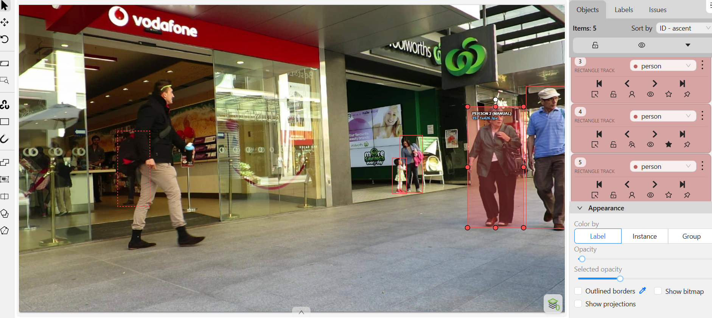

# Báo cáo cá nhân — HoVaTen-MSSV

Đổi tên file theo quy tắc `MSSV_HoTen.md`. Ví dụ: `20241234_NguyenVanAn.md`.

Đoạn video: MOT17-09, 150 frame (frame 1–150), nguồn MOTChallenge, giấy phép CC BY-NC-SA 3.0.

## 0. Thông tin học viên

- Họ tên: Nguyễn Văn Nhất
- MSSV:2A202603273
- Mã đề (A/B/C):B
- Email:26ai.nhatnv@vinuni.edu.vn
- Link repository:https://github.com/NhatNguyen28122003/K5-L2B-DAY05-NguyenVanNhat-2A202603273-MOTTracking
- Giờ bắt đầu:4:00
- Giờ kết thúc:6:00

## 1. Xem trước đoạn video (CP0)

Ghi **trước khi vẽ**, mỗi người một dòng.

| Mã | Frame xuất hiện | Frame cuối thấy được | Rẽ / dừng / đổi tốc độ ở frame | Bị che ở frame | Ghi chú |
|---|---|---|---|---|---|
| P1 |0 |149 | |41 |Bị anh chàng đi bộ che |
| P2 |0 |149 | |- |- |
| P3 |0 |149 | |- |- |
| P4 |0 |149 | |110 |Bị P2 che |
| P5 |0 |104 | |105 |Bị P2 che |

## 2. Keyframe và thời gian (CP1, CP4)

Số keyframe lấy từ kết quả `src/check_submission.py`.

| Mã | Số keyframe | Keyframe ở frame | Số frame có mặt | Keyframe / 100 frame | Thời gian (phút) | Chỗ khó |
|---|---|---|---|---|---|---|
| P1 | 13| 0, 5, 8, 11, 12, 14, 25, 35, 44, 79, 86, 93, 102|105 |12.4 | |Bị che 12 frame; ra khỏi khung sau frame 104 |
| P2 | 61|0, 2, 5, 18, 22, 23, 26, 28, 35, 40, 41, 42, 45, 46, 49, 50, 55, 58, 60, 63, 70, 74, 77, 78, 79, 81, 82, 84, 86, 89, 90, 93, 97, 98, 100, 103, 105, 106, 107, 108, 111, 113, 114, 117, 120, 121, 123, 125, 128, 130, 132, 133, 136, 138, 139, 140, 142, 144, 146, 147, 149 |150 |40.7 | |Chuyển động thay đổi liên tục, keyframe dày ở 128–149 |
| P3 | 66|0, 3, 7, 9, 12, 14, 16, 19, 21, 22, 24, 28, 29, 34, 36, 39, 40, 41, 46, 51, 55, 56, 58, 63, 66, 68, 69, 70, 72, 74, 78, 80, 82, 84, 87, 89, 93, 97, 98, 100, 101, 103, 104, 106, 107, 109, 110, 112, 114, 116, 117, 118, 122, 124, 126, 128, 130, 134, 136, 138, 140, 142, 144, 146, 148, 149 |150 |44 | |Bị che 28 frame; keyframe dày, đã giảm từ 78 xuống 66 để hết cảnh báo |
| P4 | 39| 0, 1, 17, 18, 19, 25, 29, 35, 49, 55, 59, 60, 62, 64, 69, 72, 75, 78, 79, 80, 82, 86, 87, 89, 94, 96, 99, 100, 102, 107, 109, 110, 111, 115, 117, 120, 124, 147, 148|140 |29.7 | |Vắng ở 39–48 nên từng bị tách thành 2 ID, đã gộp lại; bị che 16 frame |
| P5 | 10| 0, 5, 12, 22, 27, 35, 44, 106, 137, 142|120 |8.3 | |Vắng ở 110–136 rồi quay lại (từng là track riêng, đã gộp); bị che 14 frame |
| **Tổng** |189 | |665 | 28.4| | |

Keyframe / 100 frame của cả bài = tổng keyframe ÷ tổng số frame có mặt × 100 = 189 ÷ 665 × 100 ≈ 28,4%

Bạn đặt keyframe nhiều nhất ở người nào? Vì sao (người đó rẽ, dừng, lại gần camera hay bị che)?

Đặt keyframe nhiều nhất ở P3 lý do người đó đi từ từ mép ảnh ra đến gần camera trong các ảnh được giao

## 3. Đoạn bị che (CP2)

Người bị che: `P1`

| Mốc | Frame |
|---|---:|
| Bắt đầu bị che một phần (bật `occluded`) |29 |
| Mất hẳn (bật `outside`) |41 |
| Hiện lại (tắt `outside`) |49 |
| Thấy rõ trở lại (tắt `occluded`) |55 |

- Thời gian khuất hẳn: 8 frame = 8 ÷ 60 ≈ 0,13 giây.
- Quyết định: giữ cùng ID.
- Lý do (trả lời 3 câu: khuất bao lâu so với 60 frame, ngoại hình có khớp, chỗ hiện lại có đúng hướng và tốc độ):
Khuất khoảng 0.13 giây(8/60)
ngoại hình: khớp
có đúng hướng đúng tốc độ
...

Ảnh chụp màn hình:




## 4. Tự review ID (CP3)

Lượt 1 theo người (đi ngược từ frame 149 về 0 trên CVAT), lượt 2 theo cảnh (nhảy 10 frame). Ít nhất 3 dòng; không có lỗi thì ghi một dòng "đã kiểm hai lượt, không lỗi".

Loại lỗi dùng đúng một trong 7 mã: `id_switch`, `fragmentation`, `lost`, `merge`, `false_track`, `drift`, `flag`.

| Frame | Mã người | Loại lỗi | Mô tả một câu | Phát hiện ở lượt | Đã sửa? |
|---:|---|---|---|---|---|
| | | | | | |
| | | | | | |
| | | | | | |

Tổng hợp số lỗi theo loại:

| `id_switch` | `fragmentation` | `lost` | `merge` | `false_track` | `drift` | `flag` |
|---:|---:|---:|---:|---:|---:|---:|
| | | | | | | |

Lỗi nào chỉ lượt 2 (theo cảnh) mới thấy, lượt 1 (theo người) không thấy? Vì sao?
đã kiểm hai lượt, không lỗi
...

## 5. File xuất và kết quả tự kiểm (CP4)

| Kiểm tra | Kết quả |
|---|---|
| Tên file MOT 1.1 |NguyenVanNhat_mot.zip |
| Tên file CVAT for video 1.1 |NguyenVanNhat_cvat_video.zip |
| Số track ID khác nhau trong `gt/gt.txt` (phải là 5) | |
| Frame `outside` không có dòng trong `gt.txt` (đúng / sai) | |
| Job đã completed trên CVAT máy cá nhân | |

Dán phần tóm tắt in ra từ `src/check_submission.py`:

```
Số frame in theo CVAT (bắt đầu từ 0). Trong gt.txt, frame_id = frame CVAT + 1.

=== File MOT 1.1: NguyenVanNhat_mot.zip ===
  Số track ID: 5   |   Tổng số box: 665
  [OK]        Đúng 5 track ID.

  Track | Frame có mặt | Số frame | Đoạn vắng (outside)
      1 |   0–104      |      105 | -
      2 |   0–149      |      150 | -
      3 |   0–149      |      150 | -
      4 |   0–149      |      140 | 39–48
      5 |   0–146      |      120 | 110–136


=== File CVAT for video 1.1: NguyenVanNhat_cvat_video.zip ===

  Track | Nhãn   | Frame thấy | Keyframe | KF/100 frame | Frame occluded | Lần bật outside
      0 | person |        105 |       13 |         12.4 |             12 |               1
              Track 0: keyframe ở frame [0, 5, 8, 11, 12, 14, 25, 35, 44, 79, 86, 93, 102]
      1 | person |        150 |       61 |         40.7 |              0 |               0
              Track 1: keyframe ở frame [0, 2, 5, 18, 22, 23, 26, 28, 35, 40, 41, 42, 45, 46, 49, 50, 55, 58, 60, 63, 70, 74, 77, 78, 79, 81, 82, 84, 86, 89, 90, 93, 97, 98, 100, 103, 105, 106, 107, 108, 111, 113, 114, 117, 120, 121, 123, 125, 128, 130, 132, 133, 136, 138, 139, 140, 142, 144, 146, 147, 149]
      2 | person |        150 |       66 |         44.0 |             28 |               0
              Track 2: keyframe ở frame [0, 3, 7, 9, 12, 14, 16, 19, 21, 22, 24, 28, 29, 34, 36, 39, 40, 41, 46, 51, 55, 56, 58, 63, 66, 68, 69, 70, 72, 74, 78, 80, 82, 84, 87, 89, 93, 97, 98, 100, 101, 103, 104, 106, 107, 109, 110, 112, 114, 116, 117, 118, 122, 124, 126, 128, 130, 134, 136, 138, 140, 142, 144, 146, 148, 149]
      3 | person |        140 |       39 |         27.9 |             16 |               1
              Track 3: keyframe ở frame [0, 1, 17, 18, 19, 25, 29, 35, 49, 55, 59, 60, 62, 64, 69, 72, 75, 78, 79, 80, 82, 86, 87, 89, 94, 96, 99, 100, 102, 107, 109, 110, 111, 115, 117, 120, 124, 147, 148]
      4 | person |        120 |       10 |          8.3 |             14 |               2
              Track 4: keyframe ở frame [0, 5, 12, 22, 27, 35, 44, 106, 137, 142]

  Tổng: 189 keyframe / 665 frame có mặt = 28.4 keyframe / 100 frame
  [OK]        Đọc được 5 track từ annotations.xml.

=== Tóm tắt ===
  Lỗi: 0   |   Cảnh báo: 0
  Đạt. Dán phần tóm tắt này vào báo cáo mục 5.
```

## 6. Ba câu kết

1. Nếu được gán lại, bạn sẽ đặt keyframe khác ở đâu? Vì sao?

   ...

2. Có chỗ nào bạn không chắc "cùng ID hay ID mới"? Bạn đã quyết định và ghi chú thế nào?

   Không

3. Một lỗi ID trong job của bạn (nếu không còn sót, chọn lỗi đã sửa) có thể làm xe tự lái dự đoán sai chuyển động của người đó như thế nào? Lỗi đó ảnh hưởng MOTA hay IDF1 nhiều hơn?

   ...

## Bonus (nếu làm)

### B1 — Hai người đi sát

...

### B2 — So cách đặt keyframe

| Cách đặt | Số keyframe | Frame trôi nhất | Ghi chú |
|---|---:|---:|---|
| Đều mỗi 30 frame | | | |
| Theo chỗ đổi hướng | | | |

...

### B3 — So với tracker có sẵn

| Frame | Mã người | Tracker làm gì | Nhãn của bạn | Giải thích (đoán rồi sửa / ghép IoU / box score thấp / ngoại hình) |
|---:|---|---|---|---|
| | | | | |
| | | | | |

## 7. Tài liệu tham khảo và công cụ AI đã dùng

...
